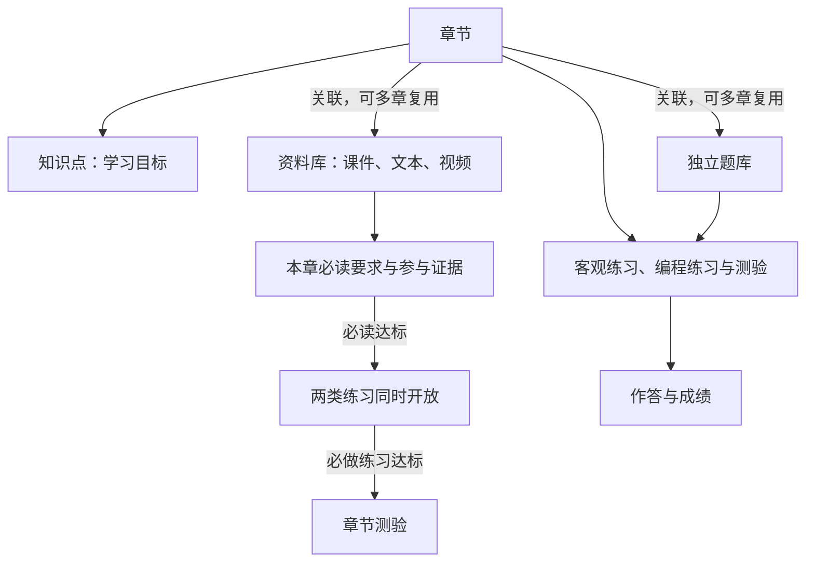

# 系统边界与数据流

`frontend` 使用 Vue 3、Pinia、TypeScript 和 Phaser 3。`game/adapters/world.ts` 是世界渲染边界；Vue 的 WorldCanvas、GameHUD、DialogueLayer 和 OverlayHost 管理画布、任务信息、脚本对白和唯一工作区。阅读器和编辑器延迟加载。API 契约见 api-contract.md。

学生界面由features/world/、features/support/learningUi.css与features/townWorkspaces.css提供响应式布局，HUD在安全视口内按三行容器流动，不根据每帧世界状态轮询。shared/modalFocus.ts统一学习弹层的初始焦点、可见控件Tab边界、Esc与调用入口恢复；地图仅保留Esc关闭，不增加WASD/方向键选择或自动聚焦目标，关闭后回到世界焦点。背后的HUD为inert，窄屏的非当前学习视图同时hidden/inert。session.navigate/back保留最多6项返回历史，open作为新的顶层入口会清空历史，关闭/退出不保留旧路径。uiPreferences仅保存设备上的字号、动效和音乐音量选择，不产生模型请求。

OverlayHost为日志、图书馆、地图、班级、设置、资料阅读与练习提供同一页头与近满屏透明外壳。gameDesign.css只在.game-workspace内定义令牌、图标标题、返回按钮、滚动条及原生单选/多选/下拉/开关/滑块的共同样式；各页不再覆写外壳尺寸和页头主题。townWorkspaces.css、learningUi.css和页面局部样式负责独立纸面卡片与透明间隙，教师主题保持独立。设计入口为design/README.md。LibraryWorkspace基于已授权/library响应，在客户端按章节分组并搜索/筛选；视图状态与滚动位置使用用户/班级隔离的sessionStorage键，阅读返回后恢复。筛选不改变服务端发布或授权。

ClassroomPanel从当前session.classes和world展示教师姓名与服务器任务状态，不增加进度写入接口。session.switchClassroom先等待阅读保存并读取目标world，确认账号、令牌、原班级和请求代次仍一致后才整体切换；失败保留原班级，成功清除旧导航及追踪状态和返回历史，工作区仍停留在我的班级。本机已按用户和班级隔离的阅读、编辑草稿不被删除。加入操作复用现有接口并刷新成员班级列表，不自动强切班级。

SettingsPanel使用账户、界面、音乐、操作、关于的可键盘导航标签页。字号和动效复用uiPreferences，musicVolume经有效数值检查并限制在0到1，直接传给当前世界的环境音频对象；没有为设置创建另一套Phaser.Game或轮询。播放开关属于当前会话，音量属于本机偏好。关于页复用LicenseContent承载许可与来源，设置内不再提供班级或资料库跳转。

`backend/app` 是一个 FastAPI 项目：auth、courses、course_content、classrooms、teaching、course_packages、materials、practice、assistant 共用 SQLAlchemy 模型、数据库会话和鉴权。无旧 Java 服务和业务兼容层。PostgreSQL 是正式状态源，Alembic 是唯一迁移机制。SQLite 只用于轻量测试。登录使用随机不透明 bearer 会话令牌，数据库只存摘要；密码采用独立盐的 scrypt。

## 核心流

提交与播放会话使用 `shared/uuid.ts` 生成幂等标识。服务端校验班级授权及当前章节任务条件。

`bootstrap.initialize_admin`在API lifespan内执行，PostgreSQL事务级advisory lock串行化首个管理员检查/创建；已有管理员时不再读取配置并覆盖密码。`users.must_change_password`由迁移`c3187f5db204`添加，既有用户默认为false；教师创建/重置学生时设true，`current_user`在服务端限制至改密/本人/退出接口。登录、改密、重置、停用与删除锁定用户行。改密、重置和停用在同一事务撤销会话，自助改密签发新的当前会话。删除账号在事务内清理关联存档；删除教师时锁定其负责的课程，核对班级归属后清理课程与历史。资料等存储对象可能被其他课程或交换包复用，课程的数据库引用随课程清除。

`student_accounts`复用班级所有权检查，学生创建与成员关系原子提交；已有本班学生幂等跳过，已有正式学生可绑定本班并沿用原密码，职员和体验账号禁止加入名册。表格只做有界内存解析与只读预览，不存储上传件；确认时重新检查，不能靠预览越权。批量移出只删除Membership，学业记录不重置。

登录标识为 `users.student_id`（String(32)，唯一索引），登录、名册与CLI共享数字校验并保留前导零；内部用户主键和所有学习证据的外键保持不变。迁移 `a91c7d20e648` 删除旧邮箱字段并撤销旧会话，不猜测学号、不删除用户或成绩。仅历史未分配账号允许该列为空，鉴权拒绝这些账号；运维按用户ID分配真实学号后可继续使用原记录。新账号必填学号或工号，唯一索引处理并发创建冲突。迁移不支持从学号反推邮箱，恢复使用升级前备份。

资料与题目独立保存。MaterialChapter 保存章节资料关联、阅读规则及排序。QuestionChapter 和 QuestionKnowledgePoint 保存题目归属。ActivityQuestion 保存固定题单及顺序。同题用于不同活动时，分别记录作答、进度和成绩。

显式导入的格式 4 课程包更新当前课程定义。PostgreSQL 保存章节、课件元信息、教学配置和学生记录，私有存储保存上传文件。

固定地图的权威配置为 `shared/world/world.json`：地图尺寸/出生点、建筑名称/用途/门前锚点、对象目录与portal源/目标；课程交互和通行策略通过本班鉴权接口下发。前端在构建时导入，后端加载同一文件；建筑交互点从建筑anchor派生，避免两处维护坐标。小镇和图书馆均由Tiled图层与素材对象渲染，建筑通过object_name关联。房屋贴图和仅含中文名称的名牌均可点击导航，门口显示小型透明素材箭头。

map工作区复用静态地图资源绘制预览，不创建额外Phaser.Game；固定当前玩家地图，筛选只改变标记，前往操作交给同一世界导航。paintMapPreview可接收逻辑裁剪范围，地图工作区仅画逻辑地图，登录背景默认仍画全render_bounds。walk_bounds限制客户端寻路和服务端位置校验，render_bounds控制外景与有界镜头范围；centered相机不在小地图边缘夹紧，bounded相机在外景边缘夹紧。逻辑地图尺寸与旧存档坐标保持一致。

玩家地图标记读取session.mapPosition：独立内存快照可保存Sprite当前浮点位置，打开地图通过WorldHandle.getMapPosition同步抓取，运动完成与暂停时刷新；不等待位置PUT成功，也不改变原1.5秒持久保存节流。world.player仍是整数服务器快照，浮点显示坐标不作为事件证据或保存payload。账号、班级、世界切换清空旧live位置并隔离旧回调，跨图仍由服务器destination决定。玩家标记始终显示，窄屏仅滚动map-stage使其可见，不移动页面焦点或重置用户筛选。

地图以建筑门口和四名角色的实际站位提供交互。靠近可交互位置时显示提示，进入学习工作区时暂停移动。

跨图通过POST /world/transition；服务端校验当前图、入口距离和本班建筑通行策略，成功后返回配置落点与世界状态。普通PUT /world/position只允许同图更新，防止绕过入口。前端保存源位置后请求传送，收到权威落点才切图；网络结果不确定时读取世界对账，不盲目重复传送。旧室内存档可原位继续并出馆。

1. 学生携带会话和 classroom_id 请求固定世界和章节任务点。
2. 服务端读取本班已开放章节，并按章汇总必读资料和活动的真实完成证据。提交前重新检查当前要求。
3. 教学资料保留 material_id/page_id。上传进入私有存储与可恢复处理状态；文件流再次鉴权。阅读参与单独入库，不冒充掌握度。
4. 概念题在服务端比对私有答案。编程提交先入库，私有用例留在后端，后台由 GoJudgeAdapter 调用独立 go-judge Python 沙箱，再在后端比较实际输出和预期值；预期值不发送给执行器，任务不依赖浏览器存活。送交结果不确定时保留待对账状态，禁止盲目重送。基础设施故障与错误答案分开。
5. 主动助教消息进入活动或资料范围隔离的会话。统一 create_agent 分别装配学习/练习提示词和工具；固定前缀只包含活动目标、角色人设和简短规则。状态在每次提问时冻结，由服务端核验并与上轮比较，以独立数据尾缀追加；不修改旧消息。完整授权文本用于词法检索，读取工具支持分页/分段，当前题反馈区分本机公开样例与服务端正式提交。

## 持久化

图书馆直接阅读使用资料级助教会话：`assistant_sessions.activity_id` 可空，`material_id` 指向当前授权资料；不创建虚拟Activity或任务，使用图书管理员角色。学习工具仅访问当前资料；练习资料由活动显式资料及当前题引用资料确定，不再任意选择章节首份资料，提交查询严格绑定当前题。恢复历史及每次提问重新检查用户、班级、章节和当前内容授权。客户端恢复键按用户、班级和活动或资料区分；普通操作不产生模型请求。

迁移 f942bc358da1 增加助教会话 revision/runtime、调用幂等键/预约额度/私有 trace 和全站模型配置。会话保存固定提示词与模板版本、上轮状态及模型消息链；聊天记录和每次工具请求/返回作为历史保留。压缩中间件在模型调用前统计系统提示、工具定义、消息和回复预留，默认32768上下文/24576触发，保留最近两轮及当前轮，不拆工具请求与返回配对。摘要与当前完整状态恢复后续聊；压缩失败只在原上下文仍可容纳时继续，否则明确失败。取消留下的不完整工具批次不作为后续模型输入，原审计仍保留。重启不自动重发模型请求。角色变更只影响新会话，权限与停用即时生效。

全站模型连接由管理员维护，管理员统一维护全平台答疑角色、开关和预算。API Key 使用 Fernet 加密，主密钥位于私有持久化存储；模型配置不进入课程包。未保存后台配置时使用环境连接，保存后整体采用数据库配置。学习与练习共享连接但工具清单独立；模型、工具、时间、单请求累计预算和每日额度共同生效，摘要调用也记账。未知模型采用保守 token 估算，不假定供应商窗口容量。

章节资料要求保存在 MaterialChapter，参与证据按学生、班级、章节和资料保存。Activity 保存本章练习或测验，题集与顺序由 ActivityQuestion 保存。

AssessmentAttempt 按用户、班级、测验保存草稿、题目 ID 和正式提交凭据。草稿修订号防止并发覆盖。交卷后统一锁定答案并建立每题的 Submission。已交试卷完成全部判定后计入章节进度。

成绩在公开payload中按 `correct_count * 100 // total` 派生为0–100整数，未判完为null，不改写既有逐题判定。

## 环境隔离

Reborn Compose 项目、数据库、卷、对象存储前缀和端口独立。主栈默认包含 db/api/web/judge/converter 五个服务，统一Compose管理；judge是独立Python隔离容器，无宿主机端口，仅API加入其内部网络。API启动只执行结构迁移、必要管理员初始化与服务启动，不再自动导入课程或归档题。课程包来自显式外部来源，后台修改不因镜像更新/重启被seed覆盖；数据库卷保存元信息与关系，私有文件卷保存媒体和解析产物。默认数据库不对外发布，开发覆盖文件也只绑定 loopback。开发、验收与生产使用独立环境，部署操作遵循显式授权。

教师后台 `/teacher/` 使用 React 和项目维护的 shadcn/ui 组件。教师在课程章节详情内编辑任务点，权限、发布和成绩由服务端判定。

`TownPreviewStudent` 按教师与班级唯一关联专属学生身份。体验会话使用独立标签页的学生令牌，服务端复核签发它的教师会话与班级权限，再按课堂作用域复用正常游戏与存档。体验学生不占正式成员关系，班级统计排除其学习事件、提交和参与记录。重玩接口只接受体验身份和绑定班级，普通开发重置仍受双开关约束。

课程媒体通过维护CLI导入当前Material：PDF保留原材料ID及content.pages，视频按来源ID新增/复用并建立章节关联，均只引用私有存储中的文件。显式发布的可信课程资料可以在章节开放后直接进入资料库，无需创建虚拟Activity或Quest；普通上传仍按原绑定与归属规则授权。未绑定活动的视频浏览不进入任务完成条件。阅读卡片继续使用原活动、必读页面ID和进度；机器字幕不会因媒体接入自动加入助教上下文。

## 班级课程与前端边界

课程实例保存负责教师，班级通过 classrooms.course_id 引用课程。章节、资料、知识点、题目和活动保存课程归属及包内稳定 ID。同课各班共用内容，开放安排、学习证据和教师体验身份归属班级。[内容规范](content-authoring.md#班级课程完整包设计)

教师按课程 ID 鉴权并编辑，学生按班级授权后解析课程。课程内容写入与学生读取使用同一课程锁；班级排期独立保存。升级时每个旧班自动成为一门课及其原班，保留内容主键和班级学习证据。

PostgreSQL使用班级事务级共享/独占advisory gate。普通运行读写先取共享gate，编辑、导入、导出、实例迁移先取独占gate，再锁实例与业务行；revision检测预览与保存之间的变化。媒体转换从queued到processing/ready/failed同样更新修订，不能让异步写入绕过导入冲突检测。运行中的助教调用阻止课程迁移/导入，未知判题派发保持原状态等待对账。SQLite测试不代替PostgreSQL并发验证。

导入先对ZIP和所有资源/领域引用做校验与影响预览，确认时重新鉴权、核对24小时有效期、包哈希、revision和学习影响，事务更新当前定义。相同请求返回原回执；被历史引用的删除、已有学习记录的跨课程替换、正式测验结构变化会拒绝。导出在独占gate下生成一致的完整包，缺失或仍转换的媒体拒绝导出，不交付假完整产物。私有暂存ZIP不直接公开；预览过期不自动删除运行媒体。

React后台位于admin/，以/teacher/独立HTML和Vite构建；游戏仍由frontend/提供/world。两个应用共用FastAPI和登录会话协议，通过正常页面导航切换，各自拥有DOM、路由、状态和样式。后台的Tailwind与shadcn/ui不进入学生bundle；离开游戏时销毁唯一Phaser实例，不用微前端或互嵌组件。React官方支持按独立子路径接入：[官方说明](https://react.dev/learn/add-react-to-an-existing-project#using-react-for-an-entire-subroute-of-your-existing-website)（2026-11-10经Context7核对）。

### 固定小镇与章节任务点

地图、四位角色的位置和职责由程序提供。管理员统一维护各角色的立绘、像素形象、人设与平台答疑设置。学习进度由本班真实的阅读记录、练习通过题目、已判定的试卷计算。

## 浏览器公开样例执行

固定 Pyodide 0.27.7 随 Web 镜像本地分发，由同源宿主页面单次拉取静态运行时包并在内存中复用，再通过消息传入 opaque-origin sandbox iframe 的独立 Worker 初始化，不传入应用凭据。沙箱 CSP 为 `connect-src 'none'`，禁止应用 API 和任意网络请求。编辑编程题时最多提前准备两个空白执行环境，取用后补充，预热失败自动剔除并在下次运行时重试；每个环境只执行一个样例，变量、文件和被修改的 Python 模块不复用。输出最多16000字符，加载最多60秒，执行最多5秒；退出、换题或停止会回收相关执行环境。预热不运行学生代码、不调用模型、不产生学习证据。Worker 不是可信执行证明。普通“运行公开样例”仅提供反馈；练习“提交代码”重新执行全部公开样例，API 校验身份、班级、活动与题目归属、样例完整性及当前输入/预期输出，并自行比较回传 stdout/stderr，保存标记为 browser_practice 的 Submission，不创建 SubmissionPayload。客户端不能指定通过数量；浏览器回传本身仍可被篡改，因此仅用作练习完成依据，不用于测验评分。网络重试复用原代码、结果和幂等键；执行失败、中止或页面/身份失效不提交完成记录。测验判题走持久化 go-judge 提交、幂等及未知派发对账路径；旧执行器token字段仅保留历史证据，不再运行旧适配器。

### 正式 Python 判题队列

测验代码提交使用go-judge执行器；历史服务器提交继续保留原回执及队列语义。评测管理的列表、数量和详情排除 browser_practice 回执；练习记录也不能转成测验旧成绩。Submission与私有SubmissionPayload复用现有数据库，prepared为持久等待状态；单API进程后台每批最多4份条件认领，逐例调用同步 `/run`，直接保存最终反馈。go-judge内部环境池/等待队列只负责临时执行调度，不代替持久业务队列。每批会等待全部4份结束后取下一批；长耗时程序可能增加后续等待，不保证所有提交秒内完成。

go-judge本身返回的Accepted仅表示程序正常退出；GoJudgeAdapter在服务端比较输出后才产生答对证据。隐藏用例的预期、实际输出和诊断不出现在学生回执。超时、无效响应或已有用例执行后的断连可能已经执行，置submission_unknown，不重送；首次连接建立失败可确认未送出，保留prepared等待恢复。服务重启只恢复prepared，dispatching转待对账。旧执行器适配器与轮询已删除。历史queued/running在启动恢复时转为待对账，token仍保留且不会转送新执行器；既有成绩和失败记录不重判，不回退API宿主机执行。

JudgeService保存全局派发开关、健康快照、工作器心跳及最近50条状态变更/管理事件。工作器约每5秒检测go-judge的连接、认证及cgroup/seccomp隔离配置；长批次期间等待批次结束再检测。检查失败时不认领任务，恢复后继续。管理员暂停与认领取同一控制行锁，暂停返回后不再新认领，已认领任务继续。状态页判定180秒内心跳为近期；这是故障观测，不是自动修复宿主机。

SubmissionDiagnostic与SubmissionPayload分离：认领时记开始时间，完成或异常时记录已收到的用例输出（stdout最多16384字符、stderr最多8192字符）、状态、CPU纳秒、内存字节及结束时间。进程被杀或数据库写入失败可能留下不完整诊断，绝不据此重放请求。只有本班教师或管理员通过专用接口读取；学生回执和助教上下文仍不含隐藏诊断。管理接口不提供Docker socket、原始宿主日志、密钥、改分或重判。单API工作器部署约束保持，不将此轮当作多进程队列协调方案。

## 教学内容移除与历史证据

Chapter、KnowledgePoint、Material、Question、Activity 使用可空deleted_at区分当前定义和历史保留行。ORM默认添加当前内容条件；仅授权历史查询显式include_deleted，身份缓存返回的实体仍经课程/删除状态校验。章节当前排序槽使用条件唯一索引，原稳定ID继续唯一。

ContentDeletionPreview保存教师/班级/课程归属、修订、目标、影响及历史指纹、确认文字和幂等结果。服务端预览和执行共用依赖闭包，课程排他锁与学生共享锁协调，确认事务复核后统一标记、解绑和递增修订。关联记录不随内容物理删除。私有媒体继续保留，导出排除只属于已移除资料的媒体。行为规则见[内容规范](content-authoring.md#级联删除与学生历史保留)。

## 逐页讲解与学习助教集成

讲解生成、校准和 TTS 是教师显式作者期操作，使用独立配置；学生只有现有学习与练习两个 create_agent 运行时。学习上下文从已授权当前资料读取整理稿（尚未整理的页退回原始解析文本并标 `excerpt_source=raw`）和有效已审校讲解，在本轮冻结后交给现有四个工具检索/分段读取。学生播放与打开提问侧栏不调用模型。旧逐页问答表保留历史，不再提供独立调用端点。讲解表随资料逻辑移除而隐藏，历史不删除。

讲解分三层：解析原文（`materials.content`，永不改写）、整理稿（`page_contents`，轻优化 + title/topic/tags，供 RAG 与讲解使用）、讲解稿（`page_narrations`，口播台词）。整理稿单独成表，避免重传覆盖已整理内容，也避免原文指纹自指；`material_tag_dicts` 按课程实例保存「别名 → 标准名」，供后续知识图谱和检索过滤。整理原文本阶段发图阈值最宽（文本不足 600 字附页图），渲染失败按页失败，页级 `image_state` 记录是否带图。

讲解有效性包含页内容、上传文件摘要、存储键和预览键；图片页替换也会使审校失效。长任务以资料行串行获取租约，心跳与释放校验本次所有者；生成完成以资料指纹和讲解修订检查防止覆盖教师修改。批量生成、全篇校准与音频批量由 `narration/jobs.py` 的后台 worker 在线程里执行（网络等待不占事件循环），请求只入队并返回 202，前端轮询 `GET .../narrations/job`；同一资料仍由 `narration_jobs` 的唯一行串行，最多三份不同资料并行。进程重启把仍在跑的任务标为中断，游标与已合并结果留在报告行，再次触发从断点继续。校准校对整理稿与原文（附真实原文、前后页或必要页图），逐窗提交并保存 fixes/issues，最后整册归并标签写入课程级字典；整册输入未变时复用上次完整报告，应用前再次验证修正仍然适用。迁移链已合并为单一 head；当前合并节点为 `b7e4c2a9f1d3`，包含 page_contents、交互练习与主链，历史已发布迁移不改写。

讲解稿与整理同口径：每 4 页一窗、从整理稿生成、一次写 4 页，窗口内页号必须与输入一致，缺页整窗失败；只写 draft，教师已接受的页不覆盖。`POST .../narrations/pipeline` 把「梳理原文 → 整册校准 → 应用修正 → 生成讲解稿」串成一条后台链，`progress.chain` 记录剩余段，失败停在当前段、重试从该段继续，已完成的阶段不重复计费；校准修正由链自动应用，整理稿保持 draft、原始文本不动。

## 体验检查点

ExperienceCheckpoint 按用户和班级保存地图位置与界面状态。恢复时服务端复核体验身份、位置和当前内容。

## 模块组织与依赖边界

源码按业务职责组织；调整模块边界时保留HTTP契约、课程包格式、数据库表与稳定ID，不用无意义兼容转发代替真实调用迁移。本节维护结构规则，验证方式见[开发手册](development.md#模块边界检查)。

### 学生端

| 模块 | 职责与边界 |
| --- | --- |
| `frontend/src/shared/session/` | 管理身份、班级、当前世界、位置、工作区导航、任务追踪与体验恢复。 |
| `frontend/src/shared/mediaCache.ts`、`pdfCache.ts`、`mediaMaintenance.ts` | 学生端有界内存媒体缓存：音频与页面图共 50 MB、PDF 文档 40 MB，保留最近使用项并做 LRU；15 分钟空闲淘汰未引用项，标签页隐藏 30 分钟清理未引用项，登录、切班、退出登录全部销毁。鉴权媒体仍由 HTTP `private, no-store` 交付，缓存只在内存中，不写入浏览器磁盘。 |
| `frontend/src/features/developer/` | 按当前体验身份和班级提供内容定位、检查点和重置。 |
| `frontend/src/features/learning/` | 阅读工作区管理资料来源、播放状态、章节阅读证据和学习目标。 |
| `frontend/src/features/practice/` | 练习工作区、题卡、编程三卡片、Monaco、公开样例运行、输出差异与整卷草稿队列集中在练习模块。练习提交以浏览器公开样例回传记录完成，测验由 API/隔离判题服务提供评分证据；普通试运行不产生进度。 |
| `frontend/scripts/generate-python-completions.py`、`frontend/public/python-completions/` | 维护期从 Python 标准库生成 manifest 和按模块 JSON（成员、签名、首行说明），编辑器输入 `模块.` 时懒加载；不手写成员表，不执行学生代码，不引入语言服务器。 |
| `frontend/src/features/assistant/`、`support/` | 助教消息/Markdown 与学习目标/目录/分栏各有归属；共用的当前题目和阅读状态契约继续留在 shared，避免学习与练习互相依赖页面。 |
| `frontend/src/game/world/` | assets、render、interactions、environment、keyboard、scene 分别拥有资源、地图人物绘制、互动与门户、环境与光照、输入、场景生命周期；`atmosphere` 只做纯光照与天气计算，`effects` 拥有阴影、光晕、目标光环、路线、浮尘等视觉反馈；`game/adapters/world.ts` 保留唯一 Phaser.Game 与 Vue 回调边界。Phaser 层不导入 Vue 页面或会话 store。`flags` / `building_access` 变化只刷新门户标记与就近提示，不重建整张地图。 |

### 学生端媒体缓存

鉴权媒体由后端以 `Cache-Control: private, no-store` 交付，浏览器不落盘；前端只在内存中缓存，按需填充，不为了填满预算而预取整份资料。默认总预算约 100 MB：

| 内容 | 预算 | 保留方式 | 清理 |
| --- | --- | --- | --- |
| 讲解音频 | 30 MB | 按班级、资料、页码做 LRU | 离开资料时清空该资料；超过预算淘汰最久未用且未被当前页引用的条目 |
| PDF / PPT 文档 | 40 MB | 最多 2 份 pdf.js 文档，关闭后保留 15 分钟 | 重开同一资料直接复用；过期、切班、退出登录或重置时销毁 |
| 页面图 | 20 MB | 预算保留；学生端当前不请求页面图，教师审校仍用当前页加后 4 页窗口 | 窗口滑出或离开审校时 revoke |
| 余量 | 10 MB | 渲染与临时 Blob | — |

清理规则：

- 未被引用的条目 15 分钟空闲后由每分钟一次的维护扫描淘汰；标签页隐藏 30 分钟后清理未引用项。
- 当前正在播放的音频或阅读中的 PDF 会被 pin，不会被 LRU 或空闲扫描误删；因此单个活动文档可以让缓存暂时超过预算，release 后再按 LRU 回收。
- 退出登录、切换班级、开发重置会立即清空全部媒体缓存并销毁 PDF 文档；音频在离开资料时释放，PDF 文档为快速重开保留最多 15 分钟。
- 视频不进入缓存，只保留当前播放的一份 Blob，离开资料即释放。
- 缓存 key 目前是资料/页码；资料替换或音频重新生成后的 15 分钟内可能复用旧内容，后续如需严格失效应由后端提供媒体版本号并加入 key。

### 教师端

`admin/src/App.tsx` 装配后台入口。章节详情复用 `features/materials/`、`features/questions/` 和 `features/activities/` 维护课件、题单与任务点。`features/management/` 提供平台角色维护界面。

### 后端

| 模块 | 所有权 |
| --- | --- |
| `course_packages/` | manifest/reader/writer/validation 负责格式与读写，catalog/paths/cleanup 负责目录生命周期，impact/apply/service 负责影响、事务应用及预览回执；narration_contract/narrations 负责可移植讲稿、媒体指纹、状态校验与目标关联，复用 narration 的运行时有效性判定；router 仅装配接口。 |
| `course_content/` | snapshot 保存当前定义快照供比较和交换；access/learning/evidence/presentation 共用授权、学习规则、证据与公开响应；activities/questions/releases/progress 维护活动、题库、发布和统计。定义快照不是学生可切换的课程版本。 |
| `classrooms/` | 班级、成员、教师独立体验身份；课程内容不再混入班级接口文件。 |
| `materials/` | storage 是本地/S3存储适配，uploads/conversion/jobs 负责上传解析与后台转换，delivery 负责私有文件与 Range 交付；用户媒体统一 no-store，学生 PDF/PPT 阅读器按 Range 取块，不整份下载。access/presentation/service/router 维护授权、响应和接口。 |
| `chapter_tasks/`、`teaching/world/` | 计算已开放章节和任务进度，复核活动准入，提供固定地图和角色位置。 |
| `experience/` | 管理体验身份的内容定位、位置检查点及其权限。 |
| `narration/` | 保留已有讲稿、校准、TTS与仓储边界。请求契约、资料授权、任务命令和环境默认值独立维护，HTTP路由与失败重试管理共用任务命令，不互调路由函数。 |

数据库事务边界由对应的应用操作确定，完整的仓储操作可封装自己的事务、锁与任务租约；拆出的子步骤不得提前提交破坏原子性，幂等回执与业务修改须保持一致。复用规则通过明确公共函数导入，不跨模块访问私有函数，不以函数内导入掩盖循环依赖。`models.py`、Alembic历史和现有学生数据不因目录整理改变。

### 样式与持续检查

学生基础样式在 `app/styles/base.css`，入口展示与关于页各自维护；世界/HUD/对白归入 `features/world/`，游戏共享控件在 `gameDesign.css`、普通工作区布局在 `townWorkspaces.css`。学习正文、支持侧卡、助教与练习样式各归功能目录。教师 `styles.css` 是导入入口，基础令牌、外壳和控件在 `styles/`，业务样式跟随 features。两端主题隔离，删除已退场 Vue 后台和旧登录/HUD覆盖，不复制主题到新模块。

`node scripts/check-modules.mjs` 检查明确的导入边界和已退场入口；`python scripts/check-python-imports.py` 静态检查后端的循环依赖与跨模块私有访问，包含函数内和常量动态导入。两项按模块改动在本机执行，配套合成测试覆盖规则。行数超过500或超过10行长于200字符只提醒人工复核，不能通过压行、机械切片或无意义转调达标。编译器、行为测试与浏览器仍负责真实正确性，依赖检查不替代它们。操作步骤见[开发手册](development.md)。

阅读任务的规则校验和进度聚合位于 `chapter_tasks/`。MaterialParticipation 为同一学生在不同班级、章节阅读同份资料分别保存证据。

### 题型扩展入口

`backend/app/question_types.py` 集中声明题型、定义校验、交卷完整性校验、客观题评分与执行方式，教师题库及课程包共用定义校验；通用提交服务保留鉴权、事务、幂等和进度，Python仍按练习浏览器/测验服务器的边界执行。未知题型明确拒绝，不回退为字符串比较。

`shared/questions.ts` 是两端共享的公开题型与答案契约，管理标签、草稿恢复、序列化和作答完整性，不包含标准答案或评分。学生组件由 `frontend/src/features/practice/questions/registry.ts` 注册，教师表单及私有答案编解码由 `admin/src/features/questions/editor-registry.tsx` 注册，两端主题保持独立。新增题型时补齐服务端策略、共享答案策略和两个组件注册表，并覆盖录入/包交换、练习提交、测验保存/锁卷及权限测试；注册表穷尽性检查防止漏配。不修改已有历史题目的题型，不重算旧成绩。
